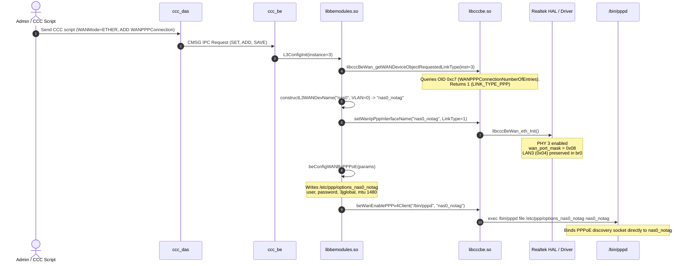

# Dependency Map & Execution Flow

## End-to-End Ethernet WAN & PPPoE Activation Map
The diagram below details how user configuration or link detection transitions through the firmware layers down to hardware port isolation and PPPoE daemon binding:

