# PPPoE Session Lifecycle & Network Integration

## State Machine Overview

```mermaid
stateDiagram-v2
    [*] --> Idle: WANConnectionDevice.3 unconfigured
    Idle --> Initializing: CCC creates WANPPPConnection.1
    Initializing --> SMUX_Setup: libcccBeWan_eth_Init creates nas0_notag
    SMUX_Setup --> Discovery: pppd spawns; sends PADI on nas0_notag
    Discovery --> LCP_Negotiation: PADS received; Session ID established
    LCP_Negotiation --> Authentication: PAP / CHAP negotiation (AUTO_AUTH)
    Authentication --> IPCP_Negotiation: IP & DNS negotiation
    IPCP_Negotiation --> Connected: /etc/ppp/ip-up executes
    Connected --> Active_Routing: Default route & NAT masquerade active
    Connected --> Disconnected: Link lost / PADT received
    Disconnected --> Discovery: holdoff 3 expires; pppd reconnects
```



## 1. Up Transition (`/etc/ppp/ip-up`)
When IPCP succeeds:
1. `pppd` executes `/etc/ppp/ip-up ppp111 nas0_notag 0 <IP> <GW>`.
2. Script generates `/var/wan_connection_notify/nas0_notag_connection_is_up`.
3. Notifies CCC backend via `ccctest`:
   ```bash
   echo "RDMNAME config;" >> /var/wan_connection_notify/nas0_notag_connection_is_up
   echo "EVENTNOTIFY 206 string ppp111;" >> /var/wan_connection_notify/nas0_notag_connection_is_up
   ccctest -f /var/wan_connection_notify/nas0_notag_connection_is_up
   ```
4. `ccc_be` receives `EVENTNOTIFY 206`:
   - Transitions `ConnectionStatus` to `"Connected"`.
   - Populates `ExternalIPAddress` and `DefaultGateway`.
   - Installs default route via `ppp111` in routing table.
   - Populates DNS servers into `/etc/resolv.conf`.
   - Inserts iptables NAT MASQUERADE rules on `ppp111`.
   - Applies TCP MSS clamping (`--clamp-mss-to-pmtu`).

## 2. Down Transition (`/etc/ppp/ip-down`)
When connection drops or PADT is received:
1. `pppd` executes `/etc/ppp/ip-down ppp111 nas0_notag ...`.
2. Emits `EVENTNOTIFY 207 string ppp111;` to `ccctest`.
3. `ccc_be` removes default route and tears down NAT bindings for `ppp111`.
4. `pppd` waits `holdoff 3` seconds and restarts discovery automatically.

