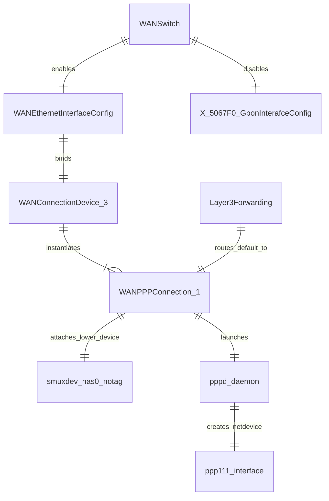

# Interface Associations & Cross-Reference Mapping

## Object Association Graph

## Resolution Verification
1. `WANEthernetInterfaceConfig` sets base name `nas0`.
2. `WANConnectionDevice.3` hosts `WANPPPConnection.1`.
3. `constructL3WANDevName` produces `nas0_notag`.
4. `setWanIpPppInterfaceName` links `nas0_notag` and `ppp111` into `WANPPPConnection.1`.
5. `Layer3Forwarding.DefaultConnectionService` binds default gateway to `WANPPPConnection.1`.

