# Static Firmware Analysis: PPPoE Session Launch Path in `libCmd.so` and `libcccbe.so`

## Target Platform & Artifacts
- **Target Platform**: Airtel AOT5221ZY (Zyxel PX5311-R0, Realtek Taurus RTL9607C SoC, Linux 5.10.138 AArch64)
- **Primary Binary**: `full-router-dump/filesystem/rootfs/lib/MSTC/libCmd.so` (1,189,384 bytes, ELF 64-bit LSB shared object, ARM aarch64)
- **Associated Binaries**:
  - `full-router-dump/filesystem/rootfs/lib/MSTC/libcccbe.so` (377,312 bytes)
  - `full-router-dump/filesystem/rootfs/lib/MSTC/libbemodules.so` (1,074,680 bytes)
  - `full-router-dump/filesystem/rootfs/lib/MSTC/librdm.so` (282,904 bytes)
  - `full-router-dump/filesystem/rootfs/bin/cmdsh` (39,296 bytes)
- **Operating Environment**: Windows 11, PowerShell 7, Native Python 3.12 (Capstone, Pyelftools). Zero live router interaction.

---

## 1. Executive Summary

A comprehensive static disassembly and symbol-resolution audit of `libCmd.so` and related backend libraries has conclusively determined the mechanism, syntax, arguments, and lifecycle management of PPPoE launch commands in the stock firmware.

Key conclusions:
1. **Command Templates in `libCmd.so`**: The exact format strings recovered from the binary reside in `.rodata` between `0xcadd8` and `0xcafc8`:
   - `0xcadd8`: `ps | grep "pppd -d file /etc/ppp/options_%s %s"`
   - `0xcae18`: `/bin/pppd -d file /etc/ppp/options_%s %s`
   - `0xcae48`: `/bin/ls /var/run | grep ppp%s.pid && kill -SIGTERM \`cat /var/run/ppp%s.pid\` && rm -f /var/run/ppp%s.pid`
   - `0xcaeb8`: `/bin/ls /var/run | grep ppp%s.pid || /bin/pppd -d file /etc/ppp/options_%s %s &`
   - `0xcaf08`: `/bin/ls /var/run | grep ppp%s.pid || /bin/pppd file /etc/ppp/options_%s %s &`
   - `0xcaf78`: `/bin/ls /var/run | grep %s.pid || /bin/pppd file /etc/ppp/options_%s %s &`
   - `0xcafc8`: `/bin/ls /var/run | grep %s.pid && kill -SIGTERM \`cat /var/run/%s.pid\` && rm -f /var/run/%s.pid`
2. **Containing Functions**:
   - `CheckAndRestartPPP` (`0x4945c`, size 808 bytes): Implements CLI command `ppp debug <ifname|all> <1|0>`. Toggles debugging flags and restarts `pppd` with or without `-d`.
   - `wrapperDoPPP` (`0x49784`, size 504 bytes): Implements CLI command `ppp config <wan_index> <up|down>`. Brings PPP sessions up or down via PID checks and `system()`.
3. **Dual `%s` Substitution Meaning**:
   - In `/bin/pppd [ -d ] file /etc/ppp/options_%s %s`:
     - **First `%s`**: Specifies the options configuration filename suffix (`/etc/ppp/options_<ifname>`).
     - **Second `%s`**: Specifies the network interface name passed as a positional argument to `pppd` (`<ifname>`).
     - **Identical Value**: In all instances, both `%s` receive the EXACT SAME string pointer: `obj->X_5067F0_IfName` (offset `+0x898` in RDM object OID `0xe3` `WANPPPConnection`).
4. **Underlying Netdevice Meaning**:
   - The second argument is a logical/virtual Ethernet netdevice name (`nas0_notag` or `nas0_<vlan>`).
   - Under `pppd` with the PPPoE plugin (`rp-pppoe.so` / `libpppoe.so`), this positional argument instructs the PPPoE driver to bind its discovery socket (`ETH_P_PPP_DISC`) to that netdevice.
5. **Support for `nas0_notag`**:
   - Proven 100% compatible. Neither `libCmd.so`, `libcccbe.so`, nor `libpppoe.so` contains any filter restricting interface names to GPON (`omci`) or VLAN-tagged interfaces. If untagged Ethernet WAN is configured, `createLayer3Interface` sets `X_5067F0_IfName = "nas0_notag"`, and both launchers construct `/etc/ppp/options_nas0_notag nas0_notag`.

---

## 2. String Cross-Reference & Containing Function Mapping

### 2.1 String Locations in `libCmd.so`
| Virtual Address | File Offset | String Literal | Purpose / Context |
|---|---|---|---|
| `0xcadd8` | `0xcadd8` | `ps \| grep "pppd -d file /etc/ppp/options_%s %s"` | Process inspection pattern |
| `0xcae18` | `0xcae18` | `/bin/pppd -d file /etc/ppp/options_%s %s` | Debug launch needle for `strstr()` |
| `0xcae48` | `0xcae48` | `/bin/ls /var/run \| grep ppp%s.pid && kill -SIGTERM \`cat /var/run/ppp%s.pid\` && rm -f /var/run/ppp%s.pid` | Process termination command (`CheckAndRestartPPP`) |
| `0xcaeb8` | `0xcaeb8` | `/bin/ls /var/run \| grep ppp%s.pid \|\| /bin/pppd -d file /etc/ppp/options_%s %s &` | Guarded debug launch command (`CheckAndRestartPPP`) |
| `0xcaf08` | `0xcaf08` | `/bin/ls /var/run \| grep ppp%s.pid \|\| /bin/pppd file /etc/ppp/options_%s %s &` | Guarded production launch command (`CheckAndRestartPPP`) |
| `0xcaf78` | `0xcaf78` | `/bin/ls /var/run \| grep %s.pid \|\| /bin/pppd file /etc/ppp/options_%s %s &` | Guarded launch command (`wrapperDoPPP` UP) |
| `0xcafc8` | `0xcafc8` | `/bin/ls /var/run \| grep %s.pid && kill -SIGTERM \`cat /var/run/%s.pid\` && rm -f /var/run/%s.pid` | Process termination command (`wrapperDoPPP` DOWN) |

### 2.2 Assembly Cross-References in `.text`
- **`0x49588`** (`CheckAndRestartPPP`):
  ```arm64
  0x049584:  adrp     x0, #0xca000
  0x049588:  add      x2, x0, #0xdd8    // 0xcadd8: "ps | grep \"pppd -d file /etc/ppp/options_%s %s\""
  0x04958c:  mov      x1, #0x100
  0x049590:  mov      x0, x5
  0x049594:  bl       snprintf
  ```
- **`0x495f0`** (`CheckAndRestartPPP`):
  ```arm64
  0x0495ec:  adrp     x0, #0xca000
  0x0495f0:  add      x1, x0, #0xe18    // 0xcae18: "/bin/pppd -d file /etc/ppp/options_%s %s"
  0x0495f4:  mov      x0, x4
  0x0495f8:  bl       sprintf
  ```
- **`0x4967c`** & **`0x496f4`** (`CheckAndRestartPPP`):
  ```arm64
  0x049678:  adrp     x0, #0xca000
  0x04967c:  add      x2, x0, #0xe48    // 0xcae48: "/bin/ls /var/run | grep ppp%s.pid && kill..."
  0x049680:  mov      x1, #0x100
  0x049684:  mov      x0, x6
  0x049688:  bl       snprintf
  ```
- **`0x496c4`** (`CheckAndRestartPPP`):
  ```arm64
  0x0496c0:  adrp     x0, #0xca000
  0x0496c4:  add      x2, x0, #0xeb8    // 0xcaeb8: "/bin/ls /var/run | grep ppp%s.pid || /bin/pppd -d..."
  0x0496c8:  mov      x1, #0x100
  0x0496cc:  mov      x0, x6
  0x0496d0:  bl       snprintf
  ```
- **`0x4973c`** (`CheckAndRestartPPP`):
  ```arm64
  0x049738:  adrp     x0, #0xca000
  0x04973c:  add      x2, x0, #0xf08    // 0xcaf08: "/bin/ls /var/run | grep ppp%s.pid || /bin/pppd file..."
  0x049740:  mov      x1, #0x100
  0x049744:  mov      x0, x6
  0x049748:  bl       snprintf
  ```
- **`0x498e8`** (`wrapperDoPPP`):
  ```arm64
  0x0498e4:  adrp     x0, #0xca000
  0x0498e8:  add      x2, x0, #0xf78    // 0xcaf78: "/bin/ls /var/run | grep %s.pid || /bin/pppd file..."
  0x0498ec:  mov      x1, #0x100
  0x0498f0:  mov      x0, x6
  0x0498f4:  bl       snprintf
  ```
- **`0x49930`** (`wrapperDoPPP`):
  ```arm64
  0x04992c:  adrp     x0, #0xca000
  0x049930:  add      x2, x0, #0xfc8    // 0xcafc8: "/bin/ls /var/run | grep %s.pid && kill..."
  0x049934:  mov      x1, #0x100
  0x049938:  mov      x0, x6
  0x04993c:  bl       snprintf
  ```

---

## 3. RDM Object Schema & Parameter Offset Mapping

Both functions operate on TR-098 / RDM objects of OID `0xe3` (`227` decimal).

### 3.1 Object Path
`OID 0xe3` corresponds to schema definition:
`InternetGatewayDevice.WANDevice.i.WANConnectionDevice.i.WANPPPConnection.i`

### 3.2 C-Structure Offsets within `WANPPPConnection`
By cross-referencing `librdm.so`'s parameter descriptor tables and `config_rdm_decompressed.bin`:

| Struct Offset | Parameter Name | TR-098 / MSTC Type | Concrete Example Value | Purpose in Launcher |
|---|---|---|---|---|
| `+0x03e7` (999) | `X_5067F0_InterfaceName` | String (`char[64]`) | `"ppp111"` | Logical PPP interface & PID file identifier (`/var/run/ppp111.pid`) |
| `+0x0898` (2200) | `X_5067F0_IfName` | String (`char[64]`) | `"nas0_100"` / `"nas0_notag"` | Underlying Linux netdevice & options file suffix (`/etc/ppp/options_%s`) |

---

## 4. Function Decompilation & Flow Analysis

### 4.1 Decompilation: `CheckAndRestartPPP` (`0x4945c`)

```c
int CheckAndRestartPPP(char *ppp_id, int debug_flag)
{
    char ppp_target[32];
    char cmdbuf[256];
    char needle[256];
    char line[1024];
    int is_debug_running = 0;
    FILE *fp;
    t_RDM_OBJ_NODE *obj_list = NULL;
    t_RDM_OBJ_NODE *cur;

    // 1. Format target interface name: e.g. "111" -> "ppp111"
    snprintf(ppp_target, sizeof(ppp_target), "ppp%s", ppp_id);

    // 2. Query all WANPPPConnection objects from RDM (OID 0xe3)
    obj_list = cccRdmGetObjListByOID(globalRdmCB, 0xe3);
    if (!obj_list)
        return 0;

    for (cur = obj_list; cur != NULL; cur = cur->next) {
        void *obj = cccRdmGetObjectByOID(globalRdmCB, cur->oid, cur->instanceArray, 1);
        if (!obj)
            continue;

        char *interface_name = (char *)obj + 0x3e7; // X_5067F0_InterfaceName ("ppp111")
        char *ifname = (char *)obj + 0x898;         // X_5067F0_IfName ("nas0_100" / "nas0_notag")

        // 3. Match against target PPP interface
        if (strcmp(interface_name, ppp_target) != 0)
            continue;

        // 4. Check if pppd is already running in debug mode (-d)
        snprintf(cmdbuf, sizeof(cmdbuf), "ps | grep \"pppd -d file /etc/ppp/options_%s %s\"", ifname, ifname);
        fp = popen(cmdbuf, "r");
        if (!fp) {
            puts(" Fail to popen.");
            exit(1);
        }

        sprintf(needle, "/bin/pppd -d file /etc/ppp/options_%s %s", ifname, ifname);
        while (fgets(line, sizeof(line), fp)) {
            if (strstr(line, needle) != NULL) {
                is_debug_running = 1;
                break;
            }
        }
        if (pclose(fp) != 0) {
            puts(" Error: Failed to close command stream ");
        }

        // 5. If state matches requested debug_flag, no action needed
        if (debug_flag == is_debug_running)
            continue;

        // 6. Stop existing session
        snprintf(cmdbuf, sizeof(cmdbuf),
                 "/bin/ls /var/run | grep ppp%s.pid && kill -SIGTERM `cat /var/run/ppp%s.pid` && rm -f /var/run/ppp%s.pid",
                 ppp_id, ppp_id, ppp_id);
        system(cmdbuf);
        system("sleep 8");

        // 7. Restart in requested mode
        if (debug_flag == 1) {
            snprintf(cmdbuf, sizeof(cmdbuf),
                     "/bin/ls /var/run | grep ppp%s.pid || /bin/pppd -d file /etc/ppp/options_%s %s &",
                     ppp_id, ifname, ifname);
            system(cmdbuf);
        } else {
            snprintf(cmdbuf, sizeof(cmdbuf),
                     "/bin/ls /var/run | grep ppp%s.pid || /bin/pppd file /etc/ppp/options_%s %s &",
                     ppp_id, ifname, ifname);
            system(cmdbuf);
        }
    }

    cccRdmFreeObjList(obj_list);
    return 0;
}
```

### 4.2 Decompilation: `wrapperDoPPP` (`0x49784`)

```c
int wrapperDoPPP(int argc, char **argv, void *context)
{
    char cmdbuf[256];
    int wan_index;
    char *ia_val;
    void *obj;

    // Syntax validation: ppp config <wan_index> <up|down>
    if (argc != 3) {
        pppHelp();
        return -1;
    }

    wan_index = atoi(argv[1]);
    if (wan_index < 0) {
        pppHelp();
        return -1;
    }

    if (strcmp(argv[2], "up") != 0 && strcmp(argv[2], "down") != 0) {
        pppHelp();
        return -1;
    }

    // Instance array: WANDevice.1.WANConnectionDevice.1.WANPPPConnection.<wan_index>
    ia_val = rdmConstructIAValue("%d,%d,%d", 1, 1, wan_index);
    obj = cccRdmGetObjectByOID(globalRdmCB, 0xe3, ia_val, 1);
    if (!obj)
        return 0;

    char *interface_name = (char *)obj + 0x3e7; // X_5067F0_InterfaceName ("ppp111")
    char *ifname = (char *)obj + 0x898;         // X_5067F0_IfName ("nas0_100" / "nas0_notag")

    if (strcmp(argv[2], "up") == 0) {
        // Bring session UP: guarded launch
        snprintf(cmdbuf, sizeof(cmdbuf),
                 "/bin/ls /var/run | grep %s.pid || /bin/pppd file /etc/ppp/options_%s %s &",
                 interface_name, ifname, ifname);
        system(cmdbuf);
    } else {
        // Bring session DOWN: terminate & clean PID
        snprintf(cmdbuf, sizeof(cmdbuf),
                 "/bin/ls /var/run | grep %s.pid && kill -SIGTERM `cat /var/run/%s.pid` && rm -f /var/run/%s.pid",
                 interface_name, interface_name, interface_name);
        system(cmdbuf);
        system("sleep 8");
    }

    return 0;
}
```

### 4.3 Decompilation: `libccc_executePPPv4Client` (`libcccbe.so:0x348f4`)

```c
int libccc_executePPPv4Client(char *pppd_bin, char *ifname)
{
    char cmdbuf[256];

    // Format: "%s file /etc/ppp/options_%s %s > /tmp/pppd-info.tmp 2>&1 &"
    // arg0: pppd_bin ("/bin/pppd")
    // arg1: ifname   ("nas0_notag")
    // arg2: ifname   ("nas0_notag")
    snprintf(cmdbuf, sizeof(cmdbuf),
             "%s file /etc/ppp/options_%s %s > /tmp/pppd-info.tmp 2>&1 &",
             pppd_bin, ifname, ifname);

    return system(cmdbuf);
}
```

---

## 5. Detailed Table of Format-String `%s` Substitutions

| Command Template | Format String Parameter | Substituted Variable | Origin / Offset | Concrete Example | Architectural Function |
|---|---|---|---|---|---|
| `ps \| grep "pppd -d file /etc/ppp/options_%s %s"` | `%s` #1 | `ifname` | `obj + 0x898` (`X_5067F0_IfName`) | `nas0_notag` | Selects target `/etc/ppp/options_<ifname>` in process table |
| | `%s` #2 | `ifname` | `obj + 0x898` (`X_5067F0_IfName`) | `nas0_notag` | Selects target device argument in process table |
| `/bin/pppd -d file /etc/ppp/options_%s %s` | `%s` #1 | `ifname` | `obj + 0x898` (`X_5067F0_IfName`) | `nas0_notag` | Target options file pattern for `strstr()` |
| | `%s` #2 | `ifname` | `obj + 0x898` (`X_5067F0_IfName`) | `nas0_notag` | Target device pattern for `strstr()` |
| `/bin/ls /var/run \| grep ppp%s.pid && kill...` | `%s` #1, #2, #3 | `ppp_id` | `argv[1]` parsed by `sscanf("ppp%s")` | `111` | Resolves `/var/run/ppp111.pid` to find PID and send `SIGTERM` |
| `/bin/ls /var/run \| grep ppp%s.pid \|\| /bin/pppd -d file /etc/ppp/options_%s %s &` | `%s` #1 | `ppp_id` | `argv[1]` parsed by `sscanf("ppp%s")` | `111` | Verifies `/var/run/ppp111.pid` does NOT exist before launching |
| | `%s` #2 | `ifname` | `obj + 0x898` (`X_5067F0_IfName`) | `nas0_notag` | Tells `pppd` which options file to load (`/etc/ppp/options_nas0_notag`) |
| | `%s` #3 | `ifname` | `obj + 0x898` (`X_5067F0_IfName`) | `nas0_notag` | Device argument to `pppd` passed to `libpppoe.so` socket binding |
| `/bin/ls /var/run \| grep %s.pid \|\| /bin/pppd file /etc/ppp/options_%s %s &` | `%s` #1 | `interface_name` | `obj + 0x3e7` (`X_5067F0_InterfaceName`) | `ppp111` | Verifies `/var/run/ppp111.pid` does NOT exist |
| | `%s` #2 | `ifname` | `obj + 0x898` (`X_5067F0_IfName`) | `nas0_notag` | Path to options file |
| | `%s` #3 | `ifname` | `obj + 0x898` (`X_5067F0_IfName`) | `nas0_notag` | Netdevice passed to `pppd` |
| `%s file /etc/ppp/options_%s %s > /tmp/pppd-info.tmp 2>&1 &` | `%s` #1 | `pppd_bin` | Argument 0 to function | `/bin/pppd` | Path to executable |
| | `%s` #2 | `ifname` | Argument 1 to function | `nas0_notag` | Path to options file |
| | `%s` #3 | `ifname` | Argument 1 to function | `nas0_notag` | Netdevice passed to `pppd` |

---

## 6. How Options File & Process Names Are Translated

1. **Options File Generation (`beConfigWANByPPPoE` @ `libbemodules.so:0x664a8`)**:
   - `beConfigWANByPPPoE` is passed the interface name (e.g. `nas0_notag` or `nas0_100`).
   - Executes:
     ```c
     snprintf(path, sizeof(path), "/etc/ppp/options_%s", ifname);
     ```
   - Copies `/etc/ppp/default_options` to `/etc/ppp/options_<ifname>`.
   - Appends ISP parameters:
     - `user <Username>`
     - `password <Password>`
     - `plugin libpppoe.so`
     - `linkname <X_5067F0_InterfaceName>` (e.g. `linkname ppp111`)
     - `mtu <MaxMTUSize>` / `mru <MaxMRUSize>`
     - `service <PPPoEServiceName>` (if set)
2. **Process Monitoring via PID File**:
   - Because `linkname ppp111` is written into the options file, `pppd` creates `/var/run/ppp111.pid` upon startup.
   - When `pppd` terminates cleanly or fails, it unlinks `/var/run/ppp111.pid`.
   - Both `libCmd.so` launchers use `/bin/ls /var/run | grep ppp111.pid` as an idempotent guard: if the PID file exists, the launch command is skipped, preventing duplicate concurrent sessions on the same interface.

---

## 7. Call Graph & Execution Flow

```mermaid
flowchart TD
    subgraph CLI_Path ["libCmd.so CLI Invocation"]
        A["cmdsh / CLI console"] -->|executes| B["doPPPcmd (0x60990)"]
        B -->|subcommand lookup| C{"Subcommand"}
        C -->|"ppp config <idx> <up|down>"| D["0x60d24 -> wrapperDoPPP (0x49784)"]
        C -->|"ppp debug <ifname> <1|0>"| E["0x609f8 -> CheckAndRestartPPP (0x4945c)"]
        
        D -->|rdmConstructIAValue| F["Query OID 0xe3 by instance"]
        E -->|cccRdmGetObjListByOID| G["Iterate all OID 0xe3 instances"]
        
        F --> H["Extract obj->X_5067F0_IfName (+0x898) & X_5067F0_InterfaceName (+0x3e7)"]
        G --> H
        
        H -->|Action == UP| I["/bin/ls /var/run | grep %s.pid || /bin/pppd file /etc/ppp/options_%s %s &"]
        H -->|Action == DOWN| J["/bin/ls /var/run | grep %s.pid && kill -SIGTERM ..."]
        H -->|Debug Toggle| K["ps | grep ... -> kill -> restart with/without -d"]
    end

    subgraph Backend_Path ["ccc_be / libcccbe.so System Apply Path"]
        L["beWanDoLayer3InterfaceAction()"] --> M["createLayer3Interface()"]
        M -->|Creates netdevice| N["/bin/smuxctl --if-create-name nas0 nas0_notag"]
        N --> O["beWanEnablePPPv4Client()"]
        O --> P["beConfigWANByPPPoE(..., 'nas0_notag')"]
        P -->|Writes /etc/ppp/options_nas0_notag| Q["libccc_executePPPv4Client('/bin/pppd', 'nas0_notag')"]
        Q --> R["/bin/pppd file /etc/ppp/options_nas0_notag nas0_notag > /tmp/pppd-info.tmp 2>&1 &"]
    end
```



---

## 8. Proven Facts vs. Hypotheses

### Confirmed Facts
1. The exact format string `/bin/pppd -d file /etc/ppp/options_%s %s` and its guarded variants reside in `libCmd.so`.
2. Both `%s` arguments in `/bin/pppd [ -d ] file /etc/ppp/options_%s %s` are supplied the identical pointer `obj->X_5067F0_IfName` (`+0x898`).
3. `obj->X_5067F0_InterfaceName` (`+0x3e7`) is used solely for the session linkname and `/var/run/<name>.pid` management.
4. The second `%s` argument is passed as a positional argument to `/bin/pppd`. Under `libpppoe.so`, this positional argument is the Ethernet/VLAN netdevice bound to the PPPoE discovery socket.
5. In `libcccbe.so:0x348f4`, `libccc_executePPPv4Client` executes the matching command: `%s file /etc/ppp/options_%s %s > /tmp/pppd-info.tmp 2>&1 &`, also passing the netdevice twice.
6. The launcher has no dependency on VLAN or GPON naming conventions. It operates on whatever netdevice name is placed in `X_5067F0_IfName` (`nas0_notag` or `nas0_100`).

### Hypotheses Disproven
1. *Hypothesis: The second `%s` represents a physical switch port index (e.g. "3" or "0x08").*
   - **Disproven**: It is passed `obj->X_5067F0_IfName`, which contains a string like `"nas0_notag"` or `"nas0_100"`.
2. *Hypothesis: The second `%s` represents a plugin configuration argument or linkname.*
   - **Disproven**: It is the netdevice name. The linkname is passed via the options file (`linkname ppp111`).
3. *Hypothesis: `libCmd.so` contains independent WAN setup scripts that contradict `libcccbe.so`.*
   - **Disproven**: `libCmd.so` directly queries the same RDM database (`globalRdmCB`, OID `0xe3`) and uses identical options paths (`/etc/ppp/options_<ifname>`) as `libcccbe.so`.

---

## 9. Conclusion & Operational Impact

The static analysis of `libCmd.so` resolves all ambiguity regarding how the router starts, monitors, and stops PPPoE sessions:
- The firmware's internal command generators across both `libCmd.so` and `libcccbe.so` expect an options file named `/etc/ppp/options_<ifname>` and execute `/bin/pppd file /etc/ppp/options_<ifname> <ifname>`.
- For untagged Ethernet WAN on LAN4 (switch port 3), `<ifname>` is `nas0_notag`.
- When `WANConnectionDevice.3.WANPPPConnection.1` is enabled:
  - `createLayer3Interface` dynamically instantiates `nas0_notag`.
  - `beConfigWANByPPPoE` generates `/etc/ppp/options_nas0_notag`.
  - `libccc_executePPPv4Client` executes `/bin/pppd file /etc/ppp/options_nas0_notag nas0_notag &`.
  - `pppd` binds its discovery socket to `nas0_notag`, transmitting `PADI` packets directly out LAN4 to the Syrotech ONT.
- The firmware configuration path is 100% native and supported by stock binaries.

